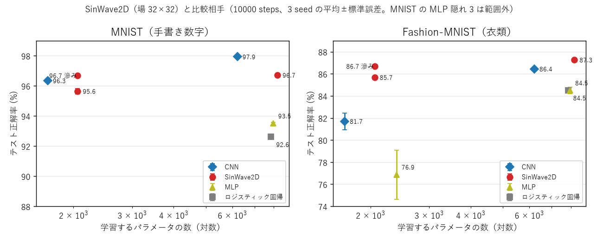

# Project Metasequoia — 光の波だけで画像を見分ける学習器

**SinWave2D** は、重みの表（ニューロンのマップ）を持たず、**光の波の干渉と回折だけ**で画像を見分ける学習器です。
学習するのは、光の通り道に置いた「縞模様の透明な板」の模様（区画ごとに 2 つの数）だけです。

このリポジトリは研究の記録です。1 次元（文字列）で作った前のプロジェクト [Sin-CNN2](https://github.com/devaf09/Sin-CNN2) を、
**画像（段階 A）→ 後から技能を足していく継続学習と分類の木（段階 B）→ 複数の人が別々に学んだ技能を持ち寄る分散学習の規格（段階 C）** へ広げることを目指しています。
いまは段階 A が終わり、段階 B の最初の実験まで進んだところで、一時停止しています。



## しくみ（光の実験装置に例えると）

```
画像（明るい画素ほど光を通すフィルム）→ [Sin の板 → 光が進んで広がる] × 16 → レンズ → スクリーンの 10 個の窓 → 一番明るい窓が答え
```

- **Sin の板**: 板を区画に分け、区画ごとに縞模様（A·sin(ωx·x + ωy·y + φ)）で光のタイミング（位相）をずらす。学習するのは縞の強さ A と始まりの位置 φ だけで、縞の向きと細かさ ω は乱数で固定。
- **回折**: 光が次の板まで進む間に広がり、離れた画素の光が重なって干渉する（コンピュータの中では角スペクトル法という標準的な計算で再現）。
- 学習するパラメータは 2,059 個（区画 8×8）〜 8,203 個（区画 16×16）。

前提知識なしの解説は [docs/introduction.md](docs/introduction.md) にあります。

## いまの成績（テスト正解率 %、10000 steps、3 seed の平均±標準誤差）

| モデル | パラメータ | MNIST（手書き数字） | Fashion-MNIST（衣類） |
|---|---|---|---|
| **SinWave2D**（場 32×32、区画 8×8） | 2,059 | 95.6±0.2 | 85.7±0.1 |
| **SinWave2D**（場 32×32、区画 16×16） | 8,203 | 96.7±0.1 | **87.3±0.1** |
| 小さな CNN | 1,674 | 96.3±0.1 | 81.7±0.8 |
| 小さな CNN | 6,218 | **97.9±0.1** | 86.4±0.1 |
| ロジスティック回帰 | 7,850 | 92.6±0.0 | 84.5±0.0 |

**2 つの技能を別々に学んで足す（融合）**: 0〜4 と 5〜9 を別々に学習し、相手のデータを使わずに 1 つにまとめた結果（3000 steps、3 seed）。

| 融合の仕方 | MNIST | Fashion-MNIST |
|---|---|---|
| 窓の明るさを足すだけ | 84.5±1.4 | 60.6±0.8 |
| 壊した画像で「どれでもない」を教え、物差しをそろえて足す | **90.7±0.0** | **80.3±0.2** |
| 比較: 10 クラスを一度に学習（seed 0） | 95.2 | 85.1 |

目標への到達度は [docs/scoreboard.md](docs/scoreboard.md)（いま 66.4 / 100 点）にまとめています。

## 長所
- **パラメータが少ない**。Fashion-MNIST では、同じくらいの大きさの小さな CNN を上回る。
- **構造が単純**で、本物の光学部品（位相板とレンズ）で組み立てられる形をしている。
- **取り消しが完全**。融合から技能を外すと、残った技能は元とまったく同じ出力に戻る。
- 別々に学んだ技能を、相手のデータなしで後から足せる見込みがある（まだ約 5 ポイントの低下がある）。

## 短所
- MNIST では小さな CNN に少し負ける。
- **計算が重い**: 板の枚数だけ FFT（フーリエ変換）を計算するので、同じくらいの大きさの CNN の約 10 倍かかる（GPU で 1 step 0.021 秒、推論 1 枚 約 10µs）。
- 技能を足すと、一度に学習した場合より正解率が下がる（2 技能で約 5 ポイント）。4 技能以上は未確認。
- 前のプロジェクト（1 次元）で一番効いた「干渉を減らす照明」は、画像では効かなかった。

## 向いている使い方
- 継続学習やモジュール性（技能の追加・取り消し・持ち寄り）の研究。精度の競争には向かない。
- 光で計算する機械学習（回折型ニューラルネット）の、少ないパラメータでの基準として。
- 波の干渉と回折が「学習」にどう使えるかを、手を動かして調べる教材として。

## 試し方

必要なもの: Python 3.10 以上、[PyTorch](https://pytorch.org/)、torchvision（GPU があると速いが、CPU でも動く）。

```bash
pip install torch torchvision
```

データ（MNIST / Fashion-MNIST）は**このリポジトリに含めていません**。torchvision で `data/` に取得してください（MNIST 約 11MB、Fashion-MNIST 約 30MB）。

```bash
python -c "import torchvision as tv; [c('data', train=t, download=True) for c in (tv.datasets.MNIST, tv.datasets.FashionMNIST) for t in (True, False)]"
```

1 ファイル版で、2 つの技能を学習して融合する例を動かす（`sinwave2d_minimal.py` は PyTorch だけで動き、このファイルだけをコピーして使えます）:

```bash
python sinwave2d_minimal.py
```

実験を再現する（例: 実験07 の最良の構成。条件の一覧は `experiments/sweeps/sweepNN.sh`）:

```bash
python experiments/exp02_sinwave.py --data fashion --seeds 0 --N 32 --scale 1 --patches 16 --steps 10000 --tag 07
```

テスト:

```bash
python -m pytest tests -q
```

## リポジトリの中身

| 場所 | 中身 |
|---|---|
| `sinwave2d_minimal.py` | 2 次元版の 1 ファイル版（v0.1.0）。学習・予測・融合・保存 |
| `sinwave_minimal.py` | 前のプロジェクトの 1 次元版（v1.3.0、文字列の分類）をそのまま取り込んだもの |
| `sinwave2d/` | 実験用の全オプション版（照明、参照波、省メモリ実行など）と、比較相手・学習・データの読み込み |
| `experiments/expNN_名前.py` | 実験のプログラム（NN は実験番号）。冒頭に着想・方法・比べるもの |
| `experiments/sweeps/sweepNN.sh` | 各実験で回した条件の一覧（そのまま再実行できる） |
| `results/expNN.txt` | 結果。1 回の実行 = 1 行の JSON（引数をすべて含む）。`results/legacy/` は番号を振り直す前の元の記録 |
| `NOTES.md` | 研究者向けの実験ノート（数字の正本） |
| `docs/experiments_guide.md` | 実験を番号順に、高校生が追える言葉で説明した資料 |
| `docs/introduction.md` | しくみの解説 |
| `docs/scoreboard.md`, `tools/scoreboard.py` | 目標への到達度（ポイント表） |
| `docs/plan_stage_A.md`, `docs/plan_stage_B.md` | 段階ごとの計画 |
| `tools/` | 集計（summarize.py）、図（plot_main.py）、結果の形式の変換（migrate_results.py） |

## データとライセンス

- このリポジトリのコードと文書は [MIT License](LICENSE)。`sinwave_minimal.py` も同じ作者の MIT。
- データは含めていません。MNIST（Yann LeCun ほか。公式のライセンスの明記はなく、一般に CC BY-SA 3.0 とされる）、Fashion-MNIST（Zalando Research、MIT License）を、それぞれの条件に従って各自で取得してください。
