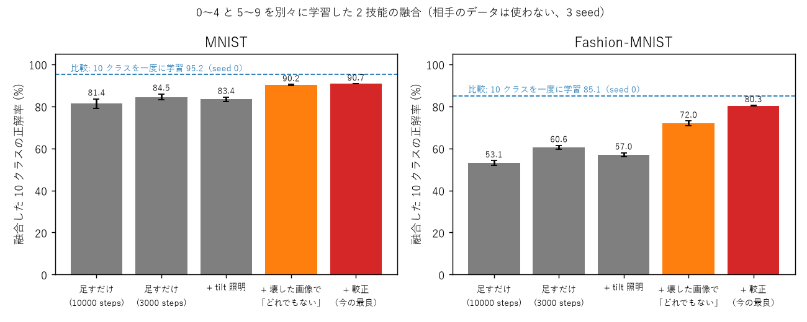

# Metasequoia 実験の歩み — 9 つの実験でたどる「光の波で画像を見分ける機械」

この資料は、Project Metasequoia（正弦の干渉と回折だけで作る学習器 SinWave を、画像に広げる研究）で行った実験を、**番号順に、目的・方法・結果・得られたもの・問題点**の形で並べたものです。
「どうやってここまで進んだのか」「どこに改良の余地があるのか」を、高校数学程度の知識で追えるように書いています。

- しくみそのものの説明は [introduction.md](introduction.md)（前提知識なしの解説）を先に読むと分かりやすいです。
- 数字の元になった記録は [NOTES.md](../NOTES.md)、実験のプログラムは `experiments/`、条件は `experiments/sweeps/sweepNN.sh`（NN = 実験番号）、結果は `results/expNN.txt` にあります。
- この資料は、うまくいかなかった実験もすべて載せています。研究では「効かなかった」という結果も、次の一手を決める大事な情報だからです。

---

## 目次

1. [この資料を読むための最小限の言葉](#1-この資料を読むための最小限の言葉)
2. [全体の流れ](#2-全体の流れ)
3. [実験の一覧](#3-実験の一覧)
4. [各実験の詳細](#4-各実験の詳細)
5. [まとめ](#5-まとめ)
6. [改良できそうな点（挑戦したい人へ）](#6-改良できそうな点挑戦したい人へ)

---

## 1. この資料を読むための最小限の言葉

| 言葉 | 意味 |
|---|---|
| 学習器 | 例をたくさん見て、仕分けのルールを自分で身につけるプログラム |
| クラス | 仕分け先の種類（例: 数字の「3」、服の「スニーカー」） |
| MNIST / Fashion-MNIST | 研究でよく使われる画像の問題集。MNIST は手書きの数字 0〜9、Fashion-MNIST は服や靴の写真 10 種類。どちらも 28×28 画素の白黒画像で、学習用 6 万枚・テスト用 1 万枚 |
| 正解率（テスト） | **学習に使っていない**画像のうち、正しく答えた割合 |
| 比較相手（ベースライン） | 昔からある方法。新しい方法の数字が良いか悪いかは、これと比べて初めて分かる |
| ロジスティック回帰 | 定番の単純な学習器。画素ごとの重みを掛けて足し、一番大きいクラスを選ぶ |
| CNN（畳み込みニューラルネット） | 画像認識の定番。小さな模様の検出器を画像の上で滑らせて特徴を拾う。この資料では、SinWave と同じくらいの大きさの小さな CNN と比べる |
| パラメータ | 学習で調整する数の個数。少ないほど軽い |
| steps（ステップ） | 学習で、少しずつ調整を繰り返す回数 |
| seed（シード） | 乱数の種。同じ条件でも seed が違うと結果が少し揺れる。大事な結果は seed を 3 つ変えて平均を取る |
| 平均±標準誤差 | 3 回の平均と、その平均のぶれの目安。「87.3±0.1」なら、本当の値はおおよそ 87.1〜87.5 の間 |
| 位相 | 波のタイミングのずれ。山の位置がどれだけずれているか |
| 干渉 | 波が重なって、強め合ったり（山と山）打ち消し合ったり（山と谷）すること |
| 回折 | 波が広がりながら進むこと |
| 技能 | 1 つの仕分けの仕事を覚えた学習器（例: 「0〜4 の数字を見分ける」）。SinWave では 1 本の光の通り道（光路） |
| 融合 | 別々に学んだ技能を、後から 1 つにまとめること |

SinWave のしくみを一言で言うと、**「画像を光に当て、模様のある透明な板（Sin の板）を何枚も通し、最後にスクリーンのどの窓が一番明るいかで答える」**です。
学習するのは板の模様だけで、模様は板を区画に分けた区画ごとの 2 つの数（振幅と初期位相）で決まります。重みの表（ニューロンのマップ）は持ちません。

---

## 2. 全体の流れ

| 段階 | 実験 | 問い | 一言でいうと |
|---|---|---|---|
| A-① 物差しを作る | 01 | 比べる相手はどのくらいできるか | 小さな CNN は学習を長くしないと本来の力が出なかった。最初の「CNN に勝った」は早とちりだった |
| A-② 2 次元でも学べるか | 02 | 1 次元（文字列）の SinWave を画像に広げて学べるか | 学べた。ただし 1 次元で強かった「典型の模様」での判定は、画像では弱い |
| A-③ 部品の見直し | 03〜06 | 1 次元で効いた工夫は画像でも効くか | 効いたのは「容量（板の区画数・枚数）」だけ。1 次元で一番効いた「干渉を減らす照明」は効かなかった |
| A-④ 最終の表 | 07 | 良い構成は定番の手法とどれくらい違うか | Fashion-MNIST では同じくらいの大きさの CNN を上回り、MNIST では少し負ける |
| B-① 技能を足す | 08〜09 | 別々に学んだ技能を足せるか（継続学習の土台） | 足すだけでは大きく崩れた。「自分の担当ではない」ことを教えると、崩れが約 5 ポイントまで縮んだ |

研究の進み方の特徴は、**前のプロジェクト（1 次元）の常識が、画像ではしばしば逆になる**ことです。たとえば 1 次元では「干渉は雑音なので減らすほど良い」でしたが、画像では干渉そのものが形の情報なので、減らしても良くなりませんでした。

---

## 3. 実験の一覧

判定: ◎ 大きな成果 / ○ 効いた / △ 一部・確認 / × 効かなかった

| 番号 | 名前 | 判定 | 一言の結果 |
|---|---|---|---|
| 01 / 01b | 比較相手を測る | △ | CNN は 10000 steps で本来の力（MNIST 96.3〜97.9%）。最初の比較は誤りだったと訂正 |
| 02 | 2 次元の基本構成 | ○ | MNIST 94.7%、Fashion 84.7%（2,059 パラメータ）。典型の模様での判定は 10 ポイント以上悪い |
| 03 | 入力の当て方と場の大きさ | ○ | 画像を拡大しない小さな場（32×32）で同じ精度、計算 1/2・メモリ 1/4 |
| 04 | 干渉を減らす照明 | × | 1 次元で一番効いた工夫が画像では効かない（±0.5、計算 3〜15 倍） |
| 05 | 容量と部品の設定 | ○ | 効くのは板の区画数と枚数。区画を増やすのが得（計算が増えない） |
| 06 | 拡大と距離の法則、参照波 | △ | 「拡大 ⇔ 距離」の法則は光では成り立つが、学習の結果では半分だけ。参照波は逆効果 |
| 07 | 良い構成の最終の表 | ◎ | MNIST 96.7%、Fashion 87.3%（8,203 パラメータ、3 seed）。Fashion では CNN 6,218 パラメータ（86.4）を上回る |
| 08 / 08b | 2 技能の融合 | × | 足すだけだと MNIST 81.4%、Fashion 53.1%（一度に学習なら 95.6 / 85.7）。照明でも直らない |
| 09 | 融合の取り違えを直す | ◎ | 壊した画像で「どれでもない」を教え、物差しをそろえると MNIST 90.7%、Fashion 80.3% |

---

## 4. 各実験の詳細

#### 実験01 / 01b「物差しを作る」△
- **目的**: SinWave の数字が良いのか悪いのかを判断するために、同じ問題で定番の手法がどのくらいできるかを先に測る。
- **方法**: ロジスティック回帰、小さなニューラルネット（MLP）、小さな CNN（パラメータ 1,674 個と 6,218 個）、学習なしの「画素の平均の形と照らし合わせる」方法を、同じ学習の仕方で測った。最初は 3000 steps（01）、CNN の数字が伸び途中に見えたので 10000 steps でも測り直した（01b）。
- **結果**（テスト正解率 %、3 seed）:

  | 方法 | パラメータ | MNIST 3000 → 10000 steps | Fashion 3000 → 10000 steps |
  |---|---|---|---|
  | ロジスティック回帰 | 7,850 | 92.8 → 92.6 | 84.9 → 84.5 |
  | CNN（小） | 1,674 | 92.4 → **96.3** | 76.3 → 81.7 |
  | CNN（中） | 6,218 | 95.4 → **97.9** | 80.9 → 86.4 |
  | SinWave2D（基本） | 2,059 | 94.7 → 95.5 | 84.7 → 85.7 |

- **得られたもの**: 公平な物差し。3000 steps では CNN が学習不足で、「SinWave が CNN に勝った」という最初の報告は誤りだった（訂正した）。
- **問題点**: 比較相手の学習の長さをそろえないと、間違った結論を出してしまう。以後は 10000 steps の値で比べる。

#### 実験02「2 次元の基本構成」○
- **目的**: 文字列を扱う 1 次元の SinWave を、画像を扱う 2 次元に広げて、そもそも学べるかを確かめる。
- **方法**: 28×28 の画像を 2 倍に拡大して 64×64 の場の中央に置き、明るい画素ほど光を通すマスクにする。Sin の板 16 枚（それぞれ 8×8 の区画）を通し、レンズで集め、円周上の 10 個の窓の明るさで答える。1 次元で窓より良かった「出力の模様全体を、クラスごとの典型の模様と照らし合わせる」判定も試した。
- **結果**（%、3 seed、3000 steps）:

  | | MNIST 窓 | MNIST 典型 | Fashion 窓 | Fashion 典型 |
  |---|---|---|---|---|
  | 学習した板 | **94.7** | 84.5 | **84.7** | 72.3 |
  | 学習していない板 | – | 83.1 | – | 71.8 |
  | 画素そのものを典型と照合 | – | 81.2 | – | 66.8 |

- **得られたもの**: 2 次元でも学べる。ロジスティック回帰（92.8 / 84.9）に近い、または上回る精度を、約 1/4 のパラメータで出せた。
- **問題点**: 典型の模様での判定は、1 次元とは逆に窓より 10 ポイント以上悪い。

#### 実験03「画像の置き方と場の大きさ」○
- **目的**: 画像を光にする方法（明るさで通す量を変える／波のタイミングをずらす）と、場の大きさ・拡大率のどれが良いかを決める。
- **方法**: 基本構成から 1 か所だけ変えて比べた（seed 0 の 1 回）。
- **結果**（%）:

  | 変更 | MNIST | Fashion | 1 step の時間 | メモリ |
  |---|---|---|---|---|
  | 基本（場 64、拡大 2） | 94.7 | 84.7 | 0.038 秒 | 369MB |
  | 位相（タイミング）で当てる | 92.7 | 85.0 | 0.038 秒 | 369MB |
  | **場 32、拡大なし** | **95.2** | **85.1** | **0.018 秒** | **92MB** |
  | 場 128、区画 16×16 | 96.6 | 86.9 | 0.127 秒 | 1477MB |

- **得られたもの**: 画像を拡大しても情報は増えない。小さな場（32×32）で同じ精度のまま、計算が半分、メモリが 1/4 になった。
- **問題点**: 場 128 の拡大 2 と 4 がほぼ同じ結果になった理由は、この時点では分からなかった（実験06 で調べた）。

#### 実験04「干渉を減らす照明」×
- **目的**: 1 次元で一番効いたのは、離れた場所どうしの干渉（「位置の雑音」）を消す照明の工夫だった。画像でも効くかを確かめる。
- **方法**: 画像をいくつかのブロックに分け、ブロックごとに光の向きを少しずつ変えた照明を何通りも当てて明るさを平均する（違うブロックどうしの干渉がちょうど打ち消し合う）。ほかに、ブロックごとにでたらめなタイミングの光を当てる方法、隣の画素の光と混ぜる「滲み層」も試した。
- **結果**（%、seed 0）:

  | 変更 | MNIST | Fashion | 計算 |
  |---|---|---|---|
  | なし（基本） | 94.7 | 84.7 | 1 倍 |
  | 照明 4 通り | 95.5 | 84.3 | 3〜4 倍 |
  | 照明 16 通り | 95.2 | 84.0 | 15 倍 |
  | 画素ごとにでたらめなタイミング | 95.2 | 85.5 | 6 倍 |
  | 滲み層 2 画素 | **96.4** | **85.2** | 1 倍 |

- **得られたもの**: 画像では、干渉を消しても良くならない。1 次元では干渉が雑音だったが、画像では画素どうしの干渉が「形」の情報そのものだからと考えられる。滲み層は少し効く。
- **問題点**: 1 次元の一番の教訓が通じないので、2 次元では別の伸ばし方を探す必要がある。

#### 実験05「容量と部品の設定」○
- **目的**: 板の枚数・区画の数、縞の細かさ（ω）を学習するか、背景光、板の間の距離、窓の形を見直す。
- **方法**: 基本構成から 1 か所だけ変えて比べた（seed 0）。
- **結果**（%）:

  | 変更 | パラメータ | MNIST | Fashion |
  |---|---|---|---|
  | 板 4 / 8 / 16（基本）/ 32 枚 | 523 / 1,035 / 2,059 / 4,107 | 85.4 / 91.9 / 94.7 / 96.1 | 79.8 / 82.5 / 84.7 / 85.9 |
  | 区画 4×4 / 8×8（基本）/ 16×16 | 523 / 2,059 / 8,203 | 89.7 / 94.7 / **96.5** | 81.6 / 84.7 / **86.9** |
  | ω も学習 | 4,107 | 95.1 | 84.9 |
  | 背景光なし、距離・窓の変更 | 2,049〜2,059 | 94.5〜95.0 | 84.5〜84.8 |

- **得られたもの**: 精度を決めるのは容量。板の枚数を増やすと計算が増えるが、区画を増やしても計算はほとんど増えないので、区画を増やすのが得。
- **問題点**: パラメータが増える（8×8 → 16×16 で 4 倍）。

#### 実験06「拡大と距離の法則、ホログラムの参照波」△
- **目的**: 実験03 の不思議（拡大 2 と 4 が同じ）を説明する見立て「画像を s 倍に拡大するのは、板の間の距離を 1/s² 倍にするのと同じ（フレネルの法則）」を確かめる。あわせて、ホログラムのように「参照用の光」を重ねて、物体の光の情報をもっと取り出せないかを試す。
- **方法**: 法則どおりなら同じになるはずの組み合わせ（拡大 4・距離 128 と拡大 2・距離 32 など）を比べた。参照波は、画像の光に一様な光（まっすぐ、または斜め）を重ねた。
- **結果**（%、seed 0）:

  | 設定 | MNIST | Fashion | 予想 |
  |---|---|---|---|
  | 拡大 2・距離 32 | 96.6 | 86.9 | |
  | 拡大 4・距離 128 | 96.5 | 86.6 | 上と同じ → 一致 |
  | 拡大 4・距離 32 | 96.7 | 86.9 | |
  | 拡大 2・距離 8 | 94.6 | 85.3 | 上と同じ → 外れ |
  | 参照波なし | 94.7 | 84.7 | |
  | 参照波 弱 → 強 | 94.5 → 90.6 | 84.1 → 82.2 | |

- **得られたもの**: 光の広がり方そのものは法則どおり（計算で相関 0.996）。学習の結果では半分だけ合った。板の区画の大きさが画素単位で決まっていて、像と一緒に伸び縮みしないためと考えられる。「拡大率」と「距離」は同じつまみだと分かったので、拡大はやめて距離で調整すればよい。
- **問題点**: 参照波は効かず、強いほど悪くなった。取り出したい情報の場所に窓が合っていない可能性があるが、未検討。

#### 実験07「良い構成の最終の表」◎
- **目的**: ここまでで良かった構成を、比較相手と同じ 10000 steps・3 seed で測り、段階 A の結論にする。
- **方法**: 場 32（拡大なし）の区画 8×8 / 16×16、滲み層 1 画素、場 64 の区画 16×16 を比べた。時間は他の処理と重ならないよう 1 本ずつ測り直した（07b）。照明を使うときにメモリを節約する計算方法も確かめた（07c）。
- **結果**（%、3 seed）:

  | 構成 | パラメータ | MNIST | Fashion | 1 step の時間 |
  |---|---|---|---|---|
  | SinWave2D 区画 8×8 | 2,059 | 95.6 | 85.7 | 0.021 秒 |
  | SinWave2D 区画 8×8 + 滲み | 2,059 | 96.7 | 86.7 | 0.021 秒 |
  | **SinWave2D 区画 16×16** | 8,203 | **96.7** | **87.3** | 0.021 秒 |
  | CNN（小） | 1,674 | 96.3 | 81.7 | 0.002 秒 |
  | CNN（中） | 6,218 | 97.9 | 86.4 | 0.002 秒 |
  | ロジスティック回帰 | 7,850 | 92.6 | 84.5 | 0.0005 秒 |

  

- **得られたもの**: Fashion-MNIST では同じくらいの大きさの CNN を上回り、MNIST では少し負ける。照明を 1 通りずつ計算すると、メモリが 1/15 になり時間は変わらない（07c）。
- **問題点**: 計算は CNN の約 10 倍かかる（板の枚数だけ FFT という計算を繰り返すため）。

#### 実験08 / 08b「2 つの技能を足す」×
- **目的**: 1 次元では、別々に学んだ技能を「窓の明るさを足すだけ」で 1 つにまとめられた（融合）。継続学習（後から仕事を追加していく学び方）の土台として、画像でも成り立つかを確かめる。
- **方法**: 技能 A は 0〜4 の画像だけ、技能 B は 5〜9 の画像だけで、別々に学ぶ。お互いの画像は一度も見せない。最後に 2 つの窓の明るさを平均し、10 個の窓の中で一番明るいものを答えにする。08b では、1 次元で融合を良くした照明と滲み層も試した。
- **結果**（%、3 seed）:

  | | MNIST | Fashion |
  |---|---|---|
  | 技能 A 単独（0〜4 の中で） | 98.9 | 88.8 |
  | 技能 B 単独（5〜9 の中で） | 97.5 | 95.8 |
  | **足すだけの融合（10 クラス）** | **81.4** | **53.1** |
  | 照明を使った融合（3000 steps） | 83.4 | 57.0 |
  | 比較: 10 クラスを一度に学習 | 95.6 | 85.7 |

- **得られたもの**: 失敗の原因がはっきりした。それぞれの技能は相手の画像を見たことがないので、見たことのない画像にも「自分の担当だ」と自信を持って窓を明るくしてしまう。Fashion では、Tシャツやコートの画像の 7〜8 割を、靴やバッグの担当の技能が取ってしまった。
- **問題点**: 1 次元で効いた照明では直らない。学習を短くすると少しましになる（自信過剰が弱まるためと考えられる）。

#### 実験09「担当ではないことを教える」◎
- **目的**: 実験08 の取り違えを、相手のデータを一切使わずに直す。
- **方法**: 3 つの工夫を組み合わせた。
  1. **壊した画像で「どれでもない」**: 自分の画像の画素をばらばらに並べ替えた画像（明るさは同じだが形がない）を見せ、「どの窓も明るくしない」ように学ばせる。見たことのない画像への自信過剰を抑えるため。
  2. **較正（物差しをそろえる）**: 技能ごとに、自分の画像を見たときのスコアの平均とばらつきで割ってから足す。2 つの技能の「声の大きさ」をそろえるイメージ。
  3. **共通の出発点**: 2 つの技能を同じ初期の板から学ばせる（1 次元で足し算ができた条件）。
- **結果**（融合した 10 クラスの正解率 %、3 seed、3000 steps）:

  | 工夫 | MNIST | Fashion |
  |---|---|---|
  | なし | 84.5 | 60.6 |
  | 壊した画像で「どれでもない」 | 90.2 | 72.0 |
  | **+ 較正 + 共通の出発点** | **90.7** | **80.3** |
  | 2 枚の画像の重ね合わせで「どれでもない」 | 73.6 | 43.7 |
  | 比較: 10 クラスを一度に学習 | 95.2 | 85.1 |

  

- **得られたもの**: 一度に学習との差が、実験08 の 14〜33 ポイントから約 5 ポイントまで縮まった。相手のデータを使わずに、後から技能を足せる見込みが出てきた。
- **問題点**: まだ約 5 ポイントの差がある。2 枚の重ね合わせを使うと、自分のクラスまで「どれでもない」と教えてしまい逆効果。共通の出発点から学んだ差分を足し合わせて 1 本の光路にする方法（1 次元では成功）は、画像では壊れた（出発点の板が未学習だったためと考えられる）。

---

## 5. まとめ

**効いたもの（大きい順）**
1. 担当ではない画像を教える工夫 + 物差しの較正（融合の崩れ −33 → −5 ポイント、実験09）
2. 容量（板の区画数・枚数。特に区画数、実験05・07）
3. 小さな場・拡大なし（精度同じで計算 1/2、メモリ 1/4、実験03）
4. 学習を長く（+0.5〜1 ポイント）、滲み層（+1 ポイント、実験04・07）
5. 照明を 1 通りずつ計算する省メモリ実行（メモリ 1/15、実験07c）

**効かなかったもの**
- 干渉を減らす照明（1 次元で一番効いた工夫、実験04・08b）
- ホログラムの参照波（実験06）
- 典型の模様での判定（窓より 10〜15 ポイント低い、実験02・07）
- ω の学習、背景光、板の間の距離、窓の形（実験05）
- 2 枚の重ね合わせで「どれでもない」、未学習の出発点からの差分の足し算（実験09）

**まだ解けていないこと**
- 融合で一度に学習との差が約 5 ポイント残る
- 4 つ以上の技能の融合、標準的な継続学習の試験（Split-MNIST）は未測定
- 計算が CNN の約 10 倍重い
- 構成の比較（実験03〜06）の多くが seed 1 本

---

## 6. 改良できそうな点（挑戦したい人へ）

- **「どれでもない」の教え方**: 画素の並べ替え以外の壊し方（一部を隠す、回転、別のデータの画像）で、残り 5 ポイントを縮められるか。
- **学習済みの共通の出発点**: いくつかのクラスや無関係な画像で学んだ板を出発点にすれば、1 次元のように差分を足して 1 本の光路にまとめられるか（計算が増えない融合）。
- **参照波の読み方**: ホログラムの原理では、参照波を重ねると物体の光に比例する成分が出力面の別の場所に現れる。窓をその場所に置けば効くかもしれない。
- **計算を軽くする**: 板の枚数を減らして区画を増やす、FFT の大きさを小さくする、など。
- **色のある画像（CIFAR）**: 色ごとに光路を分ける、明るさだけを使う、などの入力の当て方。
